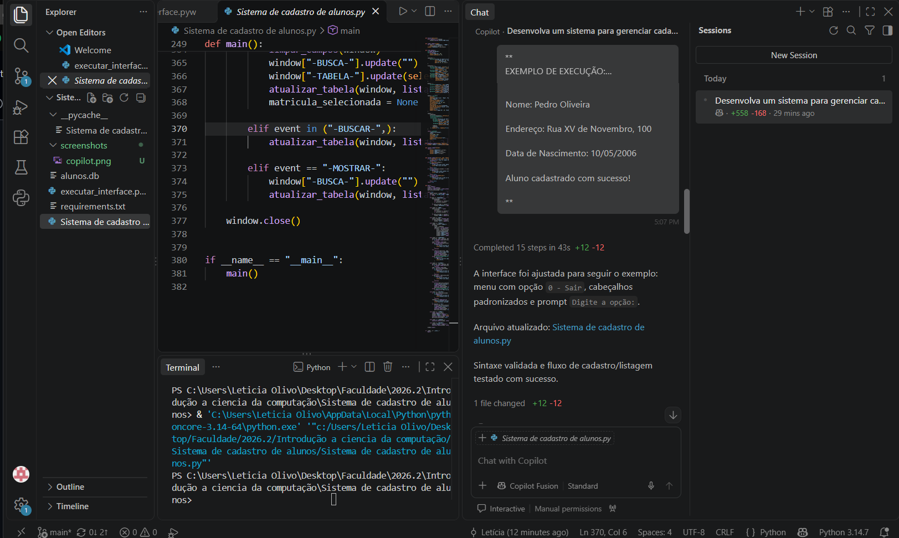
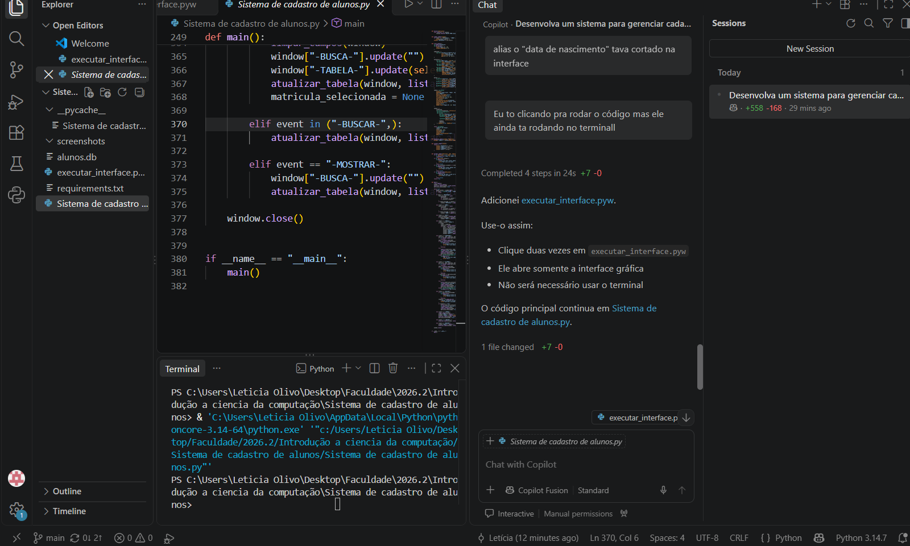

# Sistema de Cadastro de Alunos

Sistema gráfico CRUD desenvolvido em Python para cadastrar, consultar, alterar e excluir alunos. Os dados ficam armazenados localmente em um banco SQLite.

## Funcionalidades

- Cadastro de alunos
- Listagem de todos os alunos
- Busca por matrícula ou nome
- Alteração dos dados
- Exclusão com confirmação
- Matrícula única
- Validação dos campos obrigatórios
- Matrícula aceita somente números
- Nome aceita somente letras e espaços
- Formatação automática do nome com letras maiúsculas no início de cada palavra
- Máscara automática da data no formato `DD/MM/AAAA`
- Interface gráfica com tabela

## Tecnologias

- Python
- FreeSimpleGUI
- SQLite3
- GitHub Copilot

## Requisitos

- Python 3 instalado
- Biblioteca FreeSimpleGUI

## Instalação

Abra o terminal na pasta do projeto e execute:

```powershell
py -m pip install -r requirements.txt
```

## Como executar

### Pelo terminal

```powershell
py "Sistema de cadastro de alunos.py"
```

### Sem abrir o terminal

Dê um clique duplo no arquivo:

```text
executar_interface.pyw
```

## Uso

1. Preencha matrícula, nome, endereço e data de nascimento.
2. Clique em **Cadastrar** para salvar o aluno.
3. Selecione um aluno na tabela para alterar ou excluir seus dados.
4. Clique em **Alterar** para modificar o registro selecionado.
5. Clique em **Excluir** e confirme a remoção.
6. Use o campo de busca para localizar alunos por matrícula ou nome.
7. Use **Limpar** para limpar os campos do formulário.

## Banco de dados

O sistema cria automaticamente o arquivo:

```text
alunos.db
```

Ele é criado na mesma pasta do programa e contém uma tabela chamada `alunos` com os campos:

- `matricula`
- `nome`
- `endereco`
- `data_nasc`

## Estrutura do projeto

```text
Sistema de cadastro de alunos/
├── Sistema de cadastro de alunos.py
├── executar_interface.pyw
├── requirements.txt
├── alunos.db
├── screenshots/
│   ├── copilot.png
│   ├── copilot2.png
│   ├── sistema de cadastro.png
│   ├── sistema de cadastro2.png
│   ├── sistema de cadastro3.png
│   ├── sistema de cadastro4.png
│   └── sistema de cadastro5.png
└── README.md
```

## Capturas de tela

### Uso do GitHub Copilot





### Sistema de Cadastro de Alunos


